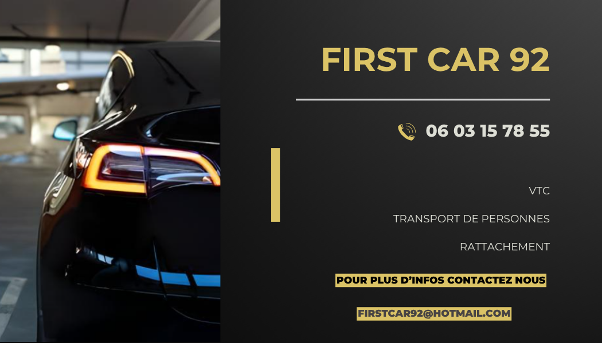

# First Car — site vitrine

Site vitrine de First Car, entreprise de transport VTC, réalisé pendant mon stage de 1re année de BTS SIO.

 

## Pages

- Accueil
- Nos véhicules (Tesla Model Y, Mercedes Viano, VW Jetta, Toyota)
- À propos
- Contact
- Politique de confidentialité et obligations légales

## Lancer le projet

Ouvrir `index.html` dans le navigateur, aucune installation. Chaque page a sa propre feuille de style (`accueil.css`, `contact.css`…).

## Suite du projet

En 2e année, j'ai repris ce client pour développer une vraie plateforme de réservation : [first-car-reservation](https://github.com/ethn924/first-car-reservation).
---

Réalisé par **Ethan Lalienne** · [GitHub](https://github.com/ethn924) · [Portfolio](https://ethn924.github.io/Portfolio/)
